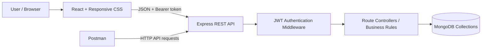

# CREDORA — Lending Operations Dashboard
## Full Stack Development Mini Project Report

**Course:** Full Stack Development (F0002)  
**Project type:** Responsive full-stack web application  
**Technology stack:** HTML5, CSS3, JavaScript, React, Node.js, Express.js, MongoDB, Mongoose, Postman, Render-ready deployment configuration  
**Project note:** Java concepts are not part of this implementation; the deliverables focus on the full-stack web-development outcomes described in the course outline.

---

## 1. Abstract

Credora is a lending-operations dashboard designed to organise customer profiles, loan accounts, repayments, and overdue-account follow-ups in a single responsive web application. The frontend is built with React and communicates with a Node.js / Express REST API. MongoDB stores the application records using Mongoose models. Authenticated users can manage customers, create loans, record repayments, review portfolio metrics, run a demonstrative delinquency audit, and mark risk records as resolved.

The project applies full-stack concepts through component-based UI development, forms and validation, protected API endpoints, CRUD operations, data modelling, environment-based configuration, and API testing with Postman. Deployment instructions are included for a separate frontend and backend on Render with MongoDB Atlas. Sample records are synthetic and intended only for academic demonstration.

## 2. Problem statement

A small lending team may have customer details, loan balances, repayment history, and overdue follow-ups stored in separate documents or spreadsheets. This can make it difficult to obtain a consistent view of outstanding balances, track repayments, and identify accounts requiring follow-up. Credora provides a single interface backed by a database and REST API to demonstrate how these operations can be coordinated in a full-stack system.

## 3. Objectives

1. Design a clean and responsive user interface for desktop and mobile screens.
2. Implement interactive pages and forms with React and JavaScript.
3. Build REST APIs for customers, loans, payments, dashboard metrics, and delinquency records.
4. Persist data in MongoDB and implement create, read, update, and archive operations.
5. Add account registration, sign-in, hashed passwords, and token-protected APIs.
6. Validate business rules such as positive payments and repayment amounts not exceeding the remaining balance.
7. Document and test the API using Postman.
8. Prepare the application for frontend and backend deployment.

## 4. Scope

**Included:** login/registration, customer directory, loan creation and status management, repayment ledger, dashboard KPIs and repayment trends, demonstrative risk audit, record resolution, API errors, a seed-data script, Postman collection, and deployment instructions.

**Not included:** live banking integrations, actual credit scoring, interest amortisation schedules, payment-gateway processing, legal lending workflows, government identity checks, multi-role approval workflows, or use with real financial data.

## 5. System architecture

**Frontend:** Vite serves the React application during development and creates the production bundle. Reusable components handle page headings, status labels, and forms. An API helper attaches the JWT to protected requests.

**Backend:** Express exposes JSON REST routes, validates input, checks authentication, runs business rules, and returns HTTP status codes. Helmet, CORS allow-listing, request-size limits, and login/registration rate limiting provide baseline safeguards.

**Database:** MongoDB stores users, customers, loans, payments, and delinquency records. Mongoose schemas define fields, validation constraints, and references.

## 6. Main modules

### 6.1 Authentication

Users can register and sign in with an email and password. Passwords are hashed with bcrypt before storage. Successful authentication returns a signed JSON Web Token. Business APIs require that token in the `Authorization: Bearer` header. Invalid or expired tokens return an unauthorised response.

### 6.2 Customer directory

The directory displays active customer records and supports searching, creating, editing, and archiving profiles. The API validates names, email format, phone length, and duplicate emails. Archiving uses a soft-delete flag so historical links remain intact.

### 6.3 Loan portfolio

A loan is linked to an active customer and records principal, remaining balance, interest rate, tenure, start date, and status. A new loan begins as approved, and its opening remaining balance equals the principal amount. The status API prevents a loan with positive outstanding balance from being marked closed.

### 6.4 Repayment processing

A repayment must have a positive amount, refer to an approved loan, and not exceed the current remaining balance. The backend performs a conditional atomic balance decrement before creating the payment ledger entry. If ledger creation fails, it attempts to restore the balance. When the remaining balance reaches zero, the loan is marked closed.

### 6.5 Dashboard

The summary endpoint returns active customer count, approved loan count, approved-loan outstanding balance, open risk count, monthly repayment totals for the last six months, a loan-status distribution, and five recent repayment entries.

### 6.6 Delinquency monitoring

The demo audit checks approved loans started more than 30 days ago that have a remaining balance. It creates or updates an open risk record and assigns LOW, MEDIUM, or HIGH according to the demonstrative overdue-day bands. A user can mark a risk record resolved. This logic is for learning only; it is not a real credit-risk model or a production lending policy.

## 7. Database design

| Collection | Main fields | Relationship / purpose |
| --- | --- | --- |
| `users` | name, email, passwordHash, timestamps | Application login identity |
| `customers` | fullName, email, phone, isDeleted, timestamps | Customer profile; archival flag |
| `loans` | customer, principalAmount, remainingBalance, interestRate, tenureMonths, startDate, loanStatus | Each loan references one customer |
| `payments` | loan, amountPaid, paymentDate | Each payment references one loan |
| `delinquencies` | loan, daysOverdue, outstandingAmount, delinquencyDate, riskLevel, resolutionStatus | Risk follow-up record linked to a loan |

### Relationships

- One customer can have multiple loan accounts.
- One loan can have multiple payment records.
- One loan can have multiple delinquency records over time.
- User records authenticate access; they are not linked to customer accounts in this teaching prototype.

## 8. API overview

| Route group | Endpoint examples | Purpose |
| --- | --- | --- |
| Health | `GET /api/health` | Verify API availability |
| Auth | `POST /api/auth/register`, `POST /api/auth/login` | Authentication |
| Dashboard | `GET /api/dashboard/summary` | Portfolio aggregation |
| Customers | `GET /api/customers`, `POST /api/customers`, `PUT /api/customers/:id`, `DELETE /api/customers/:id` | Customer CRUD / archive |
| Loans | `GET /api/loans`, `POST /api/loans`, `PATCH /api/loans/:id/status` | Loan management |
| Payments | `GET /api/payments`, `POST /api/payments` | Repayment processing |
| Delinquency | `GET /api/delinquency`, `POST /api/delinquency/audit`, `PATCH /api/delinquency/:id/resolve` | Risk review |

Detailed request examples and expected status codes are provided in `API_REFERENCE.md`.

## 9. Validation and security

- Required fields and numeric ranges are checked by frontend forms and by the backend.
- Email addresses are normalised to lowercase and checked for validity/uniqueness.
- Passwords are hashed; plaintext passwords are not stored or returned.
- The token-protected routes use JWT authentication middleware.
- Sign-in and registration requests are rate-limited.
- Helmet adds common HTTP security headers; CORS is restricted to configured frontend origins.
- JSON request size is limited and unexpected errors are converted to JSON responses.
- Payment processing validates loan status and current outstanding balance.
- Secrets belong in environment variables and must not be committed.

This is a course project, not a formal production security audit.

## 10. Testing plan

| Test case | Test action | Expected result |
| --- | --- | --- |
| API health | Send `GET /api/health` | `200` and status `ok` |
| Registration | Register with valid synthetic details | `201`, user and JWT returned |
| Invalid registration | Submit invalid email / short password | `400` validation response |
| Duplicate email | Register the same email twice | `409` conflict response |
| Protected access | Call dashboard without a token | `401` unauthorised response |
| Create customer | POST valid customer details | `201`, customer returned |
| Duplicate customer | Create another profile with same email | `409` conflict response |
| Create loan | Use an active customer and valid terms | `201`, approved loan returned |
| Invalid loan amount | Try a zero / negative principal | `400` response |
| Valid repayment | Pay less than or equal to outstanding | `201`, balance reduced |
| Excess repayment | Pay more than outstanding balance | `400`, balance unchanged |
| Full repayment | Pay exact outstanding balance | Loan marked closed |
| Delinquency audit | Run the audit against demo records | `200`, checked records reported |
| Resolve risk | PATCH a risk record | Record status becomes resolved |
| Responsive UI | Resize to mobile / desktop viewport | Navigation and tables remain usable |

**Execution status:** These are the manual checks to run in the local environment or Postman. No claim is made that these tests have been executed on a live deployment from this packaged copy. Record actual results during your evaluation rehearsal.

## 11. Course outcome mapping

- **CO1:** semantic HTML entry point, responsive CSS, labels, form input constraints, responsive layout.
- **CO2:** React components, hooks, dynamic data views, interactive forms, and charts.
- **CO3:** Express REST API routes, JSON data exchange, middleware, API error handling, and Postman.
- **CO4:** MongoDB/Mongoose persistence, relationships using ObjectId references, validation, and CRUD operations.
- **CO5:** environment variables, Vite production build, Render backend configuration, and frontend/backend deployment checklist.

## 12. How to run and demonstrate

Follow the top-level `README.md` for dependency installation, environment setup, demo seeding, running the API/client, and deployment. For a compact presentation: sign in, create a customer, create a loan, record a repayment, demonstrate invalid overpayment, run the audit, and show the Postman collection.

## 13. Limitations and future enhancements

Future improvements could include amortisation schedules, a richer activity/audit log, downloadable account statements, role-based access control, automated API tests, accessibility checks, pagination, more precise MongoDB transaction handling, and independently reviewed risk rules. Any real financial deployment would require a separate security, privacy, legal, and operational review.

## 14. Conclusion

Credora demonstrates an end-to-end full-stack workflow for a lending operations use case. The React frontend offers a responsive interface; the Express API applies validation and business rules; MongoDB persists related records; and Postman plus the deployment configuration support API verification and deployment practice. The application directly exercises the frontend, backend, database, testing, and deployment topics outlined for the Full Stack Development mini project.
